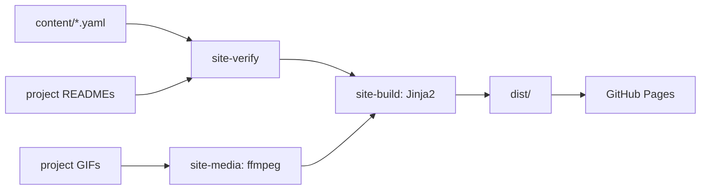

<div align="center">

# haroonkhan02.github.io

Source of my portfolio site. It is generated from a few content files, and every number it
publishes is checked against the README of the project it came from.

[](https://github.com/haroonkhan02/haroonkhan02.github.io/actions/workflows/ci.yml)
[](pyproject.toml)
[](LICENSE)

**[haroonkhan02.github.io](https://haroonkhan02.github.io/)**

</div>

## What it does

- A home page with twelve project cards. Each card shows one headline result next to the
  project's main limitation, plus links to the code and, for five projects, a browser demo.
- A page per project (`/projects/<repo>/`) with the problem, what I built, a results table,
  what the results show and the limitations.
- A check that fails the deploy when a published number no longer appears in the project's
  README, so a retrained model can't leave the site out of date.
- Posters and short clips made from each project's GIF, about ten times smaller than the
  originals. Clips load only on hover (home page) or when the figure is on screen (project
  pages), and never with reduced motion or data saver.



## How the number check works

`site-verify` pulls every numeric token out of a project's card and page (`0.951`, `2,782`,
`1.4–8.8`) and looks for each one in that project's README on GitHub. Digits that belong to a
name, such as `MRR@10` or `YOLO11`, are skipped. A missing number fails CI before the build
step runs.

It catches a number that disappeared or changed. It can't tell if a number that is still in
the README now sits next to the wrong label, so it backs up a read-through rather than
replacing it.

## Getting started

```bash
uv venv --python 3.12
uv pip install -e ".[dev]"
.venv/bin/pytest -q                              # no network, no media tools needed
.venv/bin/site-verify --repos-dir ..             # or without the flag to read from GitHub
.venv/bin/site-build
.venv/bin/python -m http.server 8000 --directory dist
```

`site-media` needs ffmpeg and local clones of the project repos next to this folder. Its output
is committed under `static/media/`, so CI never needs it.

To add a project: add a card to `content/projects.yaml`, a page to `content/pages/<repo>.yaml`,
then run `site-media`, `site-verify` and the tests.

## Repository structure

```text
content/
  profile.yaml          name, intro, skills, links
  projects.yaml         one card per project, in grid order
  pages/<repo>.yaml     the longer write-up for each project page
src/portfolio_site/
  content.py            loads and validates the YAML (grid rows, quoted numbers, one page per card)
  verify.py             site-verify: card and page numbers against each README, optional link check
  media.py              site-media: WebP posters and H.264 clips from the project GIFs
  build.py              site-build: renders the home page, project pages, 404 and sitemap
templates/              Jinja2 templates (home, project page, 404, shared nav and footer)
static/                 CSS, a small progressive-enhancement script, fonts, media
tests/                  72 tests: content rules, number check, media, rendered HTML
.github/workflows/ci.yml  lint and tests on 3.10–3.12, then verify, build and deploy to Pages
```

## Design decisions

- Plain static HTML from a small Python generator instead of a site framework. The content
  is twelve entries, and Python keeps the number check, media pipeline and tests in one
  language.
- Each card pairs the result with a limitation. A recruiter reading only the cards still sees
  where each project stops working.
- YAML numbers must be quoted. Unquoted, `0.690` loads as `0.69` and stops matching the README.
- No JavaScript is needed to read anything. The script only fades cards in and plays clips.
- No external requests at runtime: fonts and media are self-hosted, and tests fail on any
  absolute asset URL.

## Limitations

- The number check is token-based, as described above. It doesn't read context.
- The demos are hosted on Hugging Face Spaces, so they depend on that service being up.
- Text is written by hand. A changed result still needs a person to update the sentence
  around it.

## License

Code is [MIT](LICENSE) © 2026 Muhammad Haroon Khan. Geist and Geist Mono are under the
[SIL Open Font License](static/fonts/OFL.txt).
